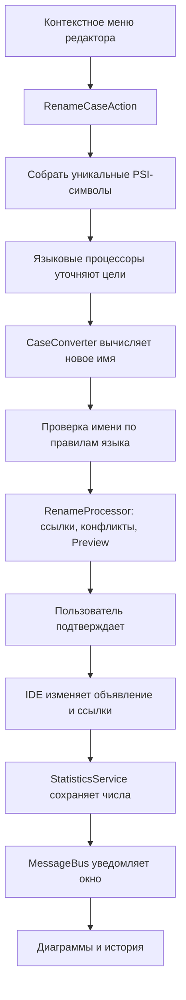

# Архитектура и объяснение кода

## Задача

Пользователь выбирает стиль имени. Плагин вычисляет новые имена для символа под курсором
или символов в выделенном блоке, а IDE переименовывает их и найденные ссылки. После завершения плагин сохраняет обезличенную
статистику и обновляет окно.

Поддерживаются одно имя и блок кода, но в обоих случаях используется семантический
Rename с обновлением использований. Текстовой замены блока нет: источником истины служит PSI.

## Поток выполнения

## Ответственность классов

| Класс | Ответственность | Почему отдельно |
|---|---|---|
| CaseConverter | Только преобразование одного имени | Тесты без IDE, нет побочных эффектов |
| RenameCaseAction | Контекст, проверки, запуск Rename | Алгоритм не зависит от UI редактора |
| CaseRenameProcessor | Пакетный рефакторинг и учёт результата | Все цели в одном Preview и Undo; статистика после выполнения |
| PluginSettings | Состояние настроек | UI не управляет XML вручную |
| SettingsConfigurable | Поля и Apply/Reset | Нажатие Cancel не должно менять рабочие настройки |
| StatisticsService | Счётчики и ограниченная история | Один источник данных для всех окон |
| StatisticsPanel | Отображение, настройки, сброс | Представление можно пересоздать без потери данных |
| plugin.xml | Регистрация расширений | IDE узнаёт, какие классы и пункты меню подключить |

Это разделение ответственности напоминает MVC: сервисы — модель, окно — представление,
действие — контроллер. Но проект не навязывает отдельный MVC-фреймворк:
используются стандартные контракты IntelliJ Platform.

## Kotlin: что нужно знать для чтения

| Конструкция | Значение в этом проекте |
|---|---|
| `package` | Пространство имён, чтобы классы не конфликтовали с другими плагинами |
| `import` | Позволяет обращаться к классу без полного имени |
| `val` | Ссылку нельзя переназначить; сам объект может быть изменяемым |
| `var` | Значение можно менять |
| `fun` | Объявление функции |
| `class` | Класс с экземплярами |
| `object` | Единственный экземпляр, например CaseConverter |
| `data class` | Класс данных с автоматически созданными equals/copy/toString |
| `enum class` | Фиксированный набор вариантов: SNAKE, CAMEL |
| `override` | Реализация/переопределение метода контракта платформы |
| `String?` | Строка или null |
| `?.` | Вызвать только если объект не null |
| `?: return` | Выйти из функции, если слева null |
| `as?` | Безопасное приведение типа: при несовпадении получается null |
| `is` | Проверка типа с автоматическим уточнением типа внутри условия |
| `when` | Выбор ветки, аналог switch, может возвращать значение |
| `{ ... }` | Лямбда — функция, переданная как значение |
| `it` | Неявное имя единственного аргумента лямбды |
| `apply` | Настроить объект и вернуть этот же объект |
| `let` | Выполнить блок с объектом в аргументе |
| `companion object` | Общие методы/константы класса, похожие на static в Java |
| `@Service`, `@State` | Аннотации с метаданными для платформы |
| `@Synchronized` | Только один поток одновременно выполняет этот метод объекта |

Не путайте `val data` с полной неизменяемостью: `data.history` может быть изменяемым списком.
Поэтому сервис выдаёт копию состояния, а для истории копирует и элементы.

## Алгоритм на примере HTTPServerURL

1. Отделяем крайние подчёркивания. Они сохранятся, если включена соответствующая настройка.
2. Правило `(\\p{Lu})(\\p{Lu}\\p{Ll})` отделяет аббревиатуру от слова:
   `HTTPServerURL → HTTP_ServerURL`.
3. Правило `([\\p{Ll}\\p{N}])(\\p{Lu})` отделяет заглавную букву после строчной/цифры:
   `HTTP_ServerURL → HTTP_Server_URL`.
4. Разбиваем по `_`, удаляем пустые части, приводим слова к нижнему регистру.
5. Для snake_case соединяем слова через `_`.
6. Для camelCase первое слово оставляем строчным, в остальных поднимаем первую букву.
7. Возвращаем крайние подчёркивания.

`\\` в строке Kotlin означает один обратный слеш регулярного выражения.
`Lu` — заглавная Unicode-буква, `Ll` — строчная, `N` — число.
`$1` и `$2` в строке замены — содержимое групп регулярного выражения.
Методы `map` и `filter` создают преобразованный/отфильтрованный список.

Алгоритм делает несколько проходов по имени и использует память пропорционально длине
имени. Стоимость реального Rename обычно определяется поиском ссылок в проекте.
Результат не обязан быть обратимым: регистр аббревиатуры теряется.

## Почему нельзя заменить выделение через Document

Редактор Document знает символы и позиции, но не знает, что два имени относятся к одному
объявлению. Замена объявления `user_name` на `userName` оставила бы старые ссылки.
Замена всех совпадений сломала бы одноимённые локальные переменные.

`TargetElementUtil` находит цель под курсором: объявление или цель ссылки.
При выделении действие проходит по листьям PSI в его границах. Токен включается только
целиком; его текст должен совпасть с именем найденного символа. Так не переименовывается
часть слова, а строки и комментарии не обрабатываются как обычные совпадения текста.
Эквивалентные PSI-цели объединяются: десять ссылок на переменную дают один пункт плана.
`substituteElementToRename` даёт языковому плагину уточнить цель (например, базовый метод).
Плагин проверяет новое имя через `RenameUtil.isValidName`.

`RenameProcessor` ищет использования, вызывает языковые проверки конфликтов и
изменяет код. Он же выполняет изменения в write command и обеспечивает Undo/Redo.
Оборачивать его в собственную строковую замену не нужно.

Во время индексации действие недоступно: поиск использований опирается на индексы.
`update()` делает только дешёвые проверки. Определение PSI-цели выполняется при запуске.
Несколько курсоров не поддерживаются. Обычное непрерывное выделение может содержать
много строк и символов. Весь план формируется до запуска Rename, поэтому ошибка имени
не оставляет первые строки уже изменёнными.

`RenameTarget` хранит цель и новое имя. `CaseRenameProcessor.prepareRenaming()` сначала
добавляет все цели в общую карту `allRenames`, затем вызывает языковую подготовку каждой
цели. Один процессор обеспечивает общий поиск ссылок, Preview и Undo/Redo. Это существенно:
цикл независимых `RenameProcessor.run()` создал бы несколько диалогов и частичные изменения.

До запуска проверяется совпадение будущих имён разных целей. Такая группа отклоняется
консервативно даже в разных областях видимости; отдельные Rename остаются доступны.

## Статистика: что считается

Переопределённый `performRefactoring()` сначала вызывает реализацию платформы,
а затем проверяет новое имя через smart pointer. Smart pointer нужен, потому что PSI-узел
может быть заменён новым объектом во время редактирования.

Считаем успешно изменённые целевые символы. Один пакет — одна операция, число символов
равно количеству подтверждённых новых имён по smart pointers. Это не количество текстовых
вхождений, строк и связанных методов, которые языковой процессор мог изменить дополнительно.
Отмена Preview не запускает performRefactoring, поэтому не увеличивает статистику.

Счётчики типа Long рассчитаны на много операций. История ограничивается лимитом.
Удаление старой истории не уменьшает накопительные итоги.
Undo/Redo относятся к коду, статистика остаётся историей использования плагина.

## Хранение и жизненный цикл

`PersistentStateComponent<Data>` — контракт сохранения:
`getState()` отдаёт снимок, `loadState()` загружает его.
IDE сериализует bean-свойства состояния в XML и восстанавливает их при запуске.
Значения по умолчанию позволяют создать состояние без аргументов.

Настройки глобальны для приложения; проекты используют общий сервис.
Поля UI сначала заполняются копией. Только Apply передаёт данные сервису.
Применение меньшего лимита сразу сокращает историю.

MessageBus передаёт событие об изменении данных. Окно подписано с Disposable:
закрытие окна освобождает подписку. Компоненты Swing обновляются в EDT;
если событие пришло из другого потока, обновление ставится в очередь.

Имена пользователей, код, пути и сетевой клиент в статистике отсутствуют.

## Где менять функциональность

- Правила регистра — CaseConverter + unit-тесты.
- Новый пользовательский параметр — PluginSettings.Data, SettingsConfigurable и README.
- Новый показатель — StatisticsService, StatisticsPanel и тесты модели.
- Поведение Rename — RenameCaseAction/CaseRenameProcessor + интеграционные тесты.
- Тексты/регистрация меню — plugin.xml.
- Целевой SDK/JDK — build.gradle.kts, затем полный прогон тестов.

## Первичные источники

- [Action System](https://plugins.jetbrains.com/docs/intellij/action-system.html).
- [PersistentStateComponent](https://plugins.jetbrains.com/docs/intellij/persisting-state-of-components.html).
- [RenameProcessor, JetBrains](https://github.com/JetBrains/intellij-community/blob/master/platform/lang-impl/src/com/intellij/refactoring/rename/RenameProcessor.java).
- [Руководство Rename](https://www.jetbrains.com/help/idea/rename-refactorings.html).

